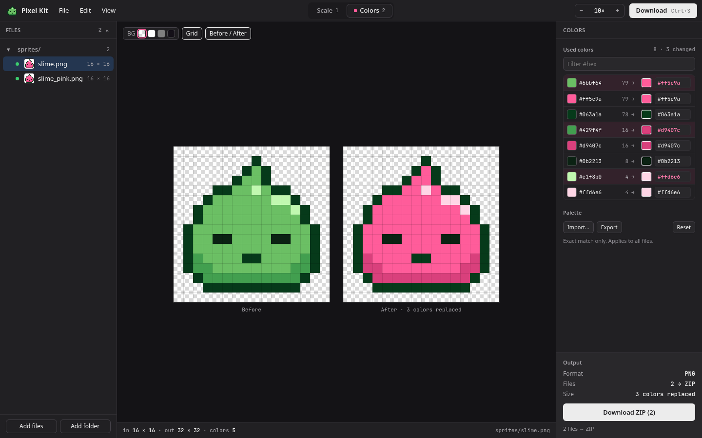

# Pixel Kit

Scale pixel art without blurring it, and replace colors in bulk.

https://yumatanemura.com/pixel-kit/



## Features

- Nearest-neighbor scaling, by scale factor or pixel size
- Exact-match color replacement, with mappings saved and loaded as JSON
- Batch processing of whole folders, with ZIP export that keeps the folder structure
- Before/after comparison, switchable preview backgrounds, and a pixel grid
- Dark mode (follows the OS setting, or set it manually)

Images are processed entirely in your browser and never uploaded.

## CLI

```sh
npm link
```

```sh
pixel-kit colors  ./art                                    # list the colors used
pixel-kit recolor ./art --map colors.json -o out           # replace colors
pixel-kit scale   ./art --scale 4 -o out                   # scale
pixel-kit process ./art --map colors.json --scale 4 -o out # replace, then scale
```

- Mapping files exported from the web app work as-is.
- `--json` prints results as JSON; `--dry-run` shows what would be written without writing.
- Existing files are never overwritten unless you pass `--force`.
- See `pixel-kit <command> --help` for details.
- The CLI handles PNG only.

## Credits

Numbers are set in JetBrains Mono (SIL Open Font License 1.1).

## License

MIT
